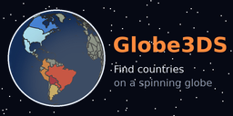
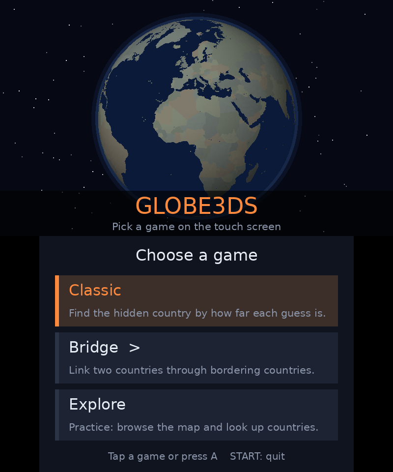
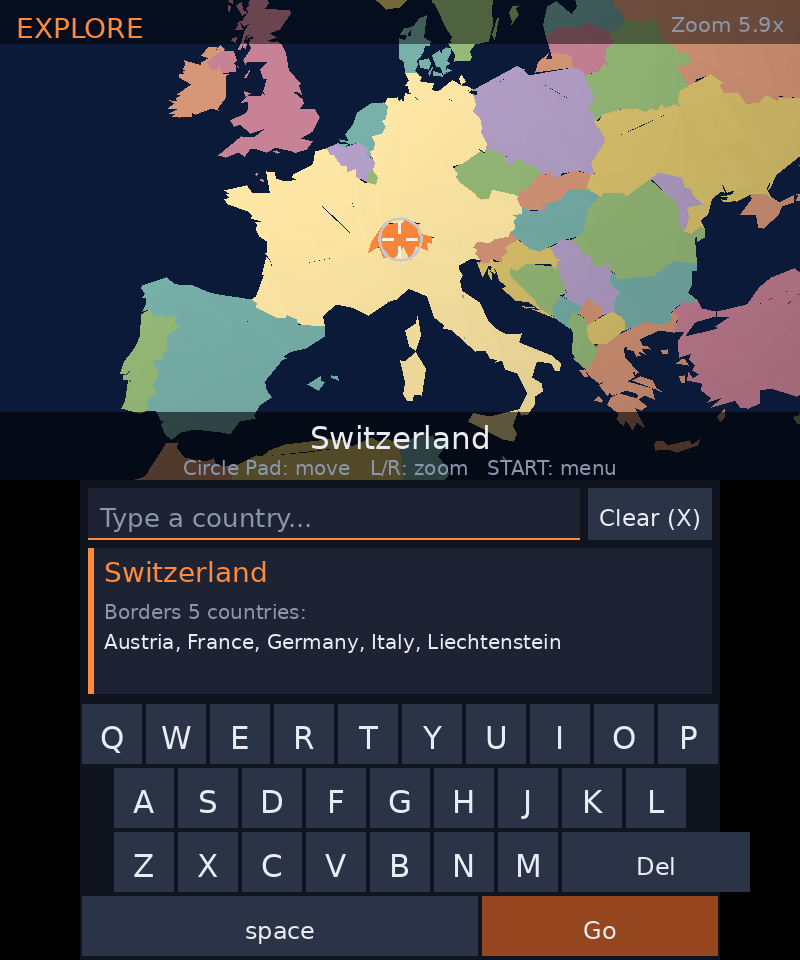

# Globe3DS



**[Download the latest release](https://github.com/cesarg3204-boop/globe-3ds/releases/latest)** · [Install with FBI](#scan-with-fbi-installs-to-the-home-menu)

Nintendo 3DS homebrew country games on a spinning 3D globe. Pick a game from the menu:

- **Classic:** a country is hidden somewhere on the globe, and you find it by guessing. Every guess is
  painted in a colour that shows how close it is. Icy blue means far away, orange and red mean you're getting warm.
- **Bridge** (pick Normal or Hard): you get a start country and a goal country, and you build a bridge between them out of
  countries that share land borders.
- **Explore:** a practice map. Browse a colourful political map of the world, see which country is under the
  crosshair, and type a country to fly to it and see its neighbours.

 

## Classic

- Type a country name on the touch keyboard. Suggestions appear as you type.
- Tap a suggestion, press **Guess**, or press **A** to guess the highlighted one.
- The top screen shows the distance from your guess's border to the hidden country's border,
  whether you got warmer or colder, and your closest guess so far.
- A neighbouring country (sharing a border) is 0 km away.
- Find it in as few guesses as you can.

## Bridge


- The start country is blue and the goal is pink. The top screen tells you the fewest countries a bridge needs.
- Guess countries in any order. Each one is coloured by how useful it is:
  **green** is on a shortest route, **yellow** is close to one (a route at most two countries longer), and **red** is off route.
- The bridge is built as soon as your guesses link the start to the goal through shared borders.
- **Normal** has no guess limit: keep going until the bridge is built.
- **Hard** gives you only the shortest bridge length plus 4 guesses. Run out and one shortest route is shown.
- Either way, SELECT twice gives up and shows a shortest route.
- Only land borders count. Borders that exist only through overseas territories (France with Brazil and Suriname)
  don't count, and small territories such as Hong Kong aren't used.

## Explore



- Move the globe with the Circle Pad. The country under the crosshair is named on the top screen, and its
  bordering countries are listed on the touch screen.
- Type a country and press **Go** (or A) to fly to it. It turns orange and its neighbours turn pale gold.
- X clears the selection.

## Controls

| Button | Action |
| --- | --- |
| Touch keyboard | Type a country name |
| A | Guess the highlighted suggestion / new game after a round |
| B | Backspace |
| D-Pad up/down | Move through suggestions or scroll the guess list |
| X | Show or hide your guesses, sorted closest first |
| Circle Pad | Spin the globe |
| L / R | Zoom out / in (up to 40x, with extra detail and small islands when zoomed in) |
| SELECT twice | Give up and reveal the answer |
| START | Back to the menu (quit from the menu) |

Your stats (games played, win rate, average guesses, streak) are saved per mode in `sdmc:/3ds/globe3ds/`.

## Installing

### Scan with FBI (installs to the HOME Menu)


1. Open **FBI** on your 3DS and choose **Remote Install → Scan QR Code**.
2. Point the camera at this QR code and confirm. FBI downloads and installs the latest `Globe3DS.cia`.
3. Globe3DS appears on the HOME Menu with its own globe banner.

The QR code points at
`https://github.com/cesarg3204-boop/globe-3ds/releases/latest/download/Globe3DS.cia`.

### Homebrew Launcher

1. Download `Globe3DS.3dsx` from the [latest release](https://github.com/cesarg3204-boop/globe-3ds/releases/latest).
2. Copy it to `sdmc:/3ds/` on your SD card.
3. Open it from the Homebrew Launcher.

Both versions work fully offline.

## Building

You need [devkitPro](https://devkitpro.org/wiki/Getting_Started) with the `3ds-dev` group (devkitARM, libctru, citro2d).

```sh
make
```

GitHub Actions builds both `Globe3DS.3dsx` and `Globe3DS.cia` on every push (see `.github/workflows/build.yml`),
and pushing a `v*` tag publishes them as a release. To build the `.cia` locally you also need
[makerom](https://github.com/3DSGuy/Project_CTR/releases) and [bannertool](https://github.com/Epicpkmn11/bannertool/releases):

```sh
bannertool makebanner -i cia/banner.png -a cia/audio.wav -o build/banner.bnr
bannertool makesmdh -s "Globe3DS" -l "Globe3DS: country guessing games on a 3D globe" -p "cesarg3204-boop" -i icon.png -o build/icon.icn
makerom -f cia -o Globe3DS.cia -elf Globe3DS.elf -rsf cia/globe3ds.rsf -icon build/icon.icn -banner build/banner.bnr -target t -exefslogo
```

Or with Docker:

```sh
docker run --rm -v "$PWD":/src -w /src devkitpro/devkitarm make
```

## Country data

Borders come from [Natural Earth](https://www.naturalearthdata.com/) 1:50m Admin 0 countries, which is in the public domain.
`tools/gen_countries.py` turns it into `source/countrydata.c`: it simplifies and triangulates the borders
for the globe, and precomputes the shortest border-to-border distance between every pair of countries.

```sh
pip install shapely numpy mapbox_earcut
curl -LO https://raw.githubusercontent.com/nvkelso/natural-earth-vector/master/geojson/ne_50m_admin_0_countries.geojson
python3 tools/gen_countries.py ne_50m_admin_0_countries.geojson source/countrydata.c
```

## Icon and banner

`icon.png` (the menu icon) and `cia/banner.png` + `cia/audio.wav` (the HOME Menu banner and its chime) are
drawn from the same Natural Earth shapes:

```sh
python3 tools/make_icon.py ne_50m_admin_0_countries.geojson icon.png
python3 tools/make_banner.py ne_50m_admin_0_countries.geojson cia/
```

## Desktop preview

`tools/sim` builds the game for your computer with a stand-in for the 3DS libraries, replays a
script of button presses and renders the screens to PNG files. It's useful for checking layout changes
without a console:

```sh
tools/sim/run.sh tools/sim/test.script /tmp/globe3ds-shots
SIM_SEED=2 tools/sim/run.sh tools/sim/bridge.script /tmp/globe3ds-bridge
```

`SIM_SEED` fixes the random puzzle so a script can be replayed.
